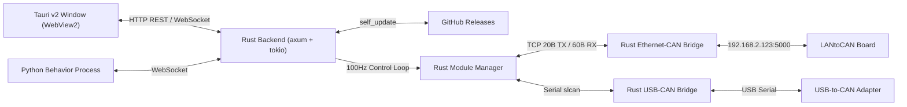
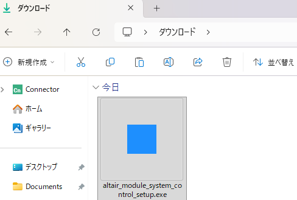
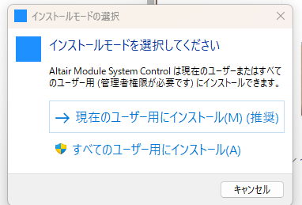
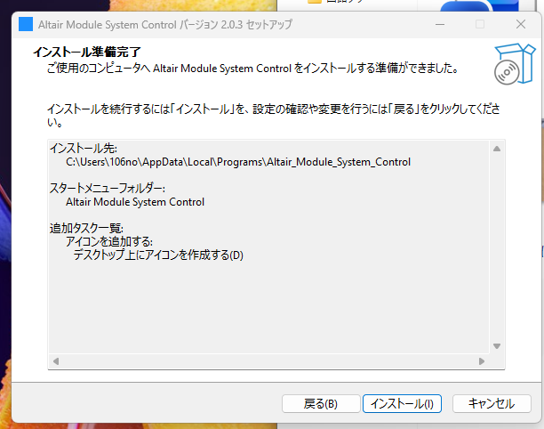

# Altair Module System Control v2

Altair Module System の各モジュールを Windows 11 上の軽量ネイティブアプリケーションとして制御するための統合制御システムです。
Node.js や npm、ROS2 環境を必要とせず、Rust と Tauri v2 によってコンパイルされた単一の実行ファイル `altair_module_system_control.exe` で最新の Ethernet-CAN 変換基板および USB-to-CAN アダプタによる 100Hz 制御や、Blockly / Python による自動制御プログラムの実行が可能です。

## 特徴

* Rust と Tauri v2 によるネイティブ構成のため、npm や Node.js が不要で、Windows 11 標準の WebView2 上で高精細かつ省メモリに動作します。
* `self_update` クレートによる GitHub Releases 連携を内蔵しており、アプリ起動時に新バージョンを自動確認し、ワンクリックで最新版の `.exe` へ自己更新できます。
* Ethernet-CAN 基板および USB-to-CAN の両方に対応し、GUI上でワンクリックで切り替えと接続ができます。
* モジュール構成を JSON プロファイルとして保存や切り替え、インポート、エクスポートが可能です。
* Google Blockly を用いたビジュアルプログラミングから Python コードを自動生成し、足回り運動学ブロックやゲームパッド連動を含む動作プログラムをそのまま実行できます。

## システム構成



## インストール方法

初めて利用する場合は、Windows 向けのインストーラーを利用することで、必要なファイル一式とデスクトップショートカットを簡単にセットアップできます。

* GitHub Releases の最新リリースから `altair_module_system_control_setup.exe` をダウンロードします。
* ダウンロードしたインストーラーを実行します。管理者権限は不要で、そのままウィザードに従って進めるだけでインストールが完了します。
* デスクトップまたはスタートメニューに作成された `Altair Module System Control` のショートカットから起動できます。
* アプリの更新は起動時に自動確認され、画面上のボタンから最新バージョンへそのまま更新できます。




altair_module_system_control_setup.exeを起動します






## 起動とビルド方法

ビルド済みの実行ファイルを直接起動する場合は、プロジェクトルートにある実行ファイルを実行します。

```powershell
.\altair_module_system_control.exe
```

ウィンドウを開かずにバックグラウンドのWebサーバーとして起動する場合は `--server` オプションを付与します。

```powershell
.\altair_module_system_control.exe --server
```

ソースコードからリリースビルドを行う場合は以下のコマンドを実行します。

```powershell
cargo build --release
```


## GitHub Actions による自動ビルドと自動アップデート

* `main` ブランチへコードをプッシュするか、`v2.0.1` のようなタグをプッシュすると、`.github/workflows/release.yml` の GitHub Actions が自動的に起動します。
* GitHub Actions 上でバージョン番号の自動採番、`Cargo.toml` と `tauri.conf.json` のバージョン同期、`cargo build --release` による Windows 用 `.exe` のビルド、そして GitHub Releases への公開までがすべて自動で実行されます。
* アプリ起動時には `self_update` クレートが GitHub リポジトリ `Altairu/Altair_module_system_control` の Releases を自動確認します。新しいバージョンが公開されている場合は左メニュー下部に更新ボタンが表示され、クリックすると最新バイナリをダウンロードして実行ファイルを自己更新します。

## 使い方

### Ethernet-CAN 基板での接続

* PCの有線LANアダプタに固定IPアドレスとして `192.168.2.100`、サブネットマスクとして `255.255.255.0` を設定します。
* 画面左側の Connection パネルで Ethernet タブを選択します。
* IPアドレスに `192.168.2.123`、ポート番号に `5000` が入力されていることを確認し、Connect ボタンを押します。

### USB-to-CAN での接続

* 画面左側の Connection パネルで USB タブを選択します。
* 自動探索にチェックを入れるか、COMポートを選択して Connect ボタンを押します。

### モジュールの制御開始

* Dashboard 画面で各MDDモジュールの制御モードやPIDゲインを設定します。
* 左パネルの Send Params & Start ボタンを押すと、各モジュールへPIDゲインと制御モードが送信され、制御ループが開始されます。
* 各モジュールカード上部の UI操作送信 トグルをONにすると、スライダーやボタンの操作がリアルタイムにハードウェアへ送信されます。
