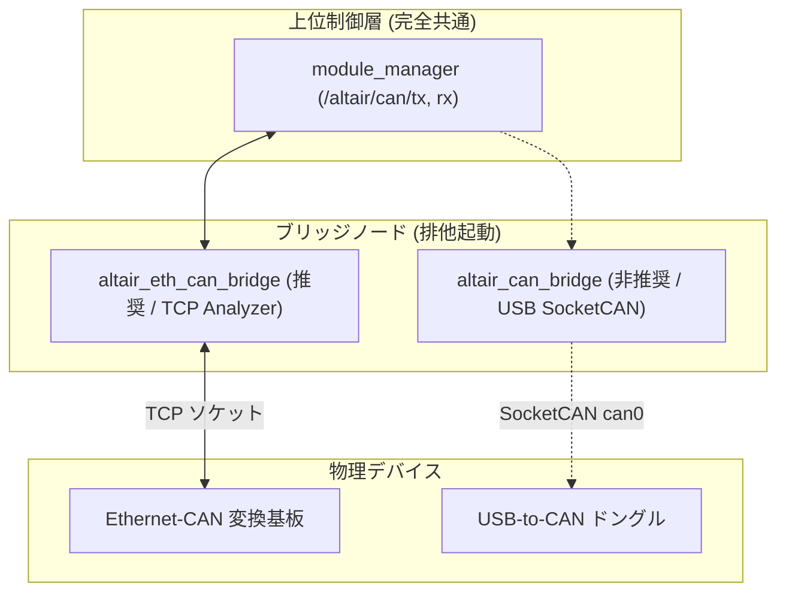
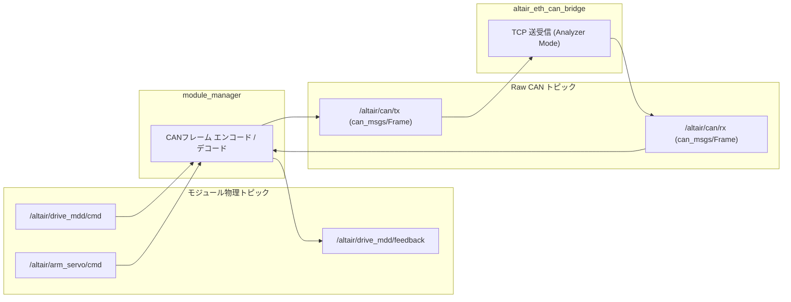
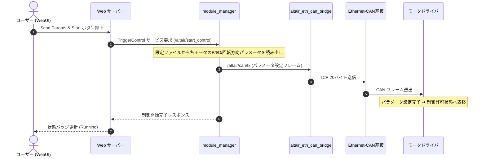

# Altair Framework システム設計書 (architecture.md)

本ドキュメントは、CANバス（1 Mbps）で統一されたアクチュエータ制御モジュール群 Altair Module System を一括制御するROS2パッケージ altair_framework の全体アーキテクチャ、通信データフロー、および運用モデルについて詳細に解説する仕様設計書です。

---

## 全体アーキテクチャ概要

本システムは、モジュール制御や自律動作を司る上位制御層と、物理 CAN バスとパケット中継を行う通信ブリッジ層を完全に分離した疎結合設計を採用しています。

### システム構成図 (推奨：単一PC運用)

ロボット搭載PC（NUC等）に全ノードを集約し、Ethernet-CAN 基板を有線LAN直結する構成です。競技会場での無線トラブルによる制御途絶を防ぎます。

```mermaid
flowchart TD
    subgraph UI ["操作端末 (PC / スマホ)"]
        Browser["ブラウザ / WebUI"]
    end

    subgraph RobotPC ["ロボット搭載 PC (NUC)"]
        WebServer["altair_web_server (FastAPI / WS)"]
        Mgr["module_manager (altair_core)"]
        Runner["behavior_runner (altair_core)"]
        Behavior["user_behaviors (自律動作スクリプト)"]
        EthBridge["altair_eth_can_bridge (TCP Client)"]
    end

    subgraph Hardware ["CAN ハードウェア"]
        EthBoard["Ethernet-CAN 変換基板 (W5500 + STM32)"]
        Modules["CAN モジュール群 (MDD / サーボ / 電磁弁)"]
    end

    Browser <-->|WiFi (HTTP / WebSocket)| WebServer
    WebServer <-->|ROS2 トピック / サービス| Mgr
    WebServer <-->|ROS2 サービス| Runner
    Runner <-->|サブプロセス監視| Behavior
    Behavior <-->|ROS2 トピック| Mgr
    Mgr <-->|/altair/can/tx, rx (500Hz)| EthBridge
    EthBridge <-->|有線LAN (TCP Port 5000)| EthBoard
    EthBoard <-->|1Mbps CANバス| Modules
```

---

## 運用形態のバリエーション

altair_framework は、ロボットの重量や競技要件に応じて2通りの運用形態に対応しています。

* 単一 PC 運用 (スタンドアロン運用 / 推奨)
  * ロボット搭載 PC（NUC など）で全ノード（web_server_node, module_manager, behavior_runner, altair_eth_can_bridge）を一括起動します。
  * 操縦者は手元のスマートフォンやノート PC から、ロボットの WiFi アクセスポイントへ接続してブラウザ上で操作します。
  * 500Hz のモータ制御ループと Ethernet-CAN 通信がすべて有線 LAN および PC 内部で完結するため、会場の電波環境に左右されず最も安全です。
* 2台 PC 運用 (ロボット側 NUC + 操縦 PC)
  * ロボット側 PC では通信ブリッジノード（altair_eth_can_bridge または altair_can_bridge）のみを起動します。
  * 操縦 PC 側で module_manager や Web サーバーを実行し、2台の PC 間を WiFi（ROS2 DDS）で接続します。
  * ロボット側の計算負荷を極小化したい場合に適しています。

---

## 通信ブリッジ層の切り替え仕様

物理ハードウェアの接続方式に応じて、以下の2つのブリッジノードを選択できます。



* altair_eth_can_bridge (推奨)
  * 通信方式: TCP ソケット (初期値: 192.168.2.123:5000)
  * プロトコル: Analyzer Mode (20 バイト送信 / 60 バイト受信)
  * 特徴: 高速、低遅延、USB デバイス認識のズレや sudo 権限への依存が不要。
* altair_can_bridge (非推奨 / レガシー互換用)
  * 通信方式: Linux SocketCAN (slcan)
  * 特徴: USB-to-CAN アダプタ専用。起動スクリプトのオプション（--usb）により後方互換として維持。

---

## ROS2 トピックとデータフロー

上位層（module_manager）は、modules_config.json の定義に基づいてモジュール別の物理値トピックと Raw CAN フレームトピックの相互変換を行います。



---

## 制御開始シーケンス

安全仕様として、MDD モータドライバは起動直後にパラメータ設定モード（Setup Mode）で待機します。WebUI からパラメータ送信ボタンを押すことで、全パラメータが一括送出され、安全に 500Hz の制御ループへ移行します。


